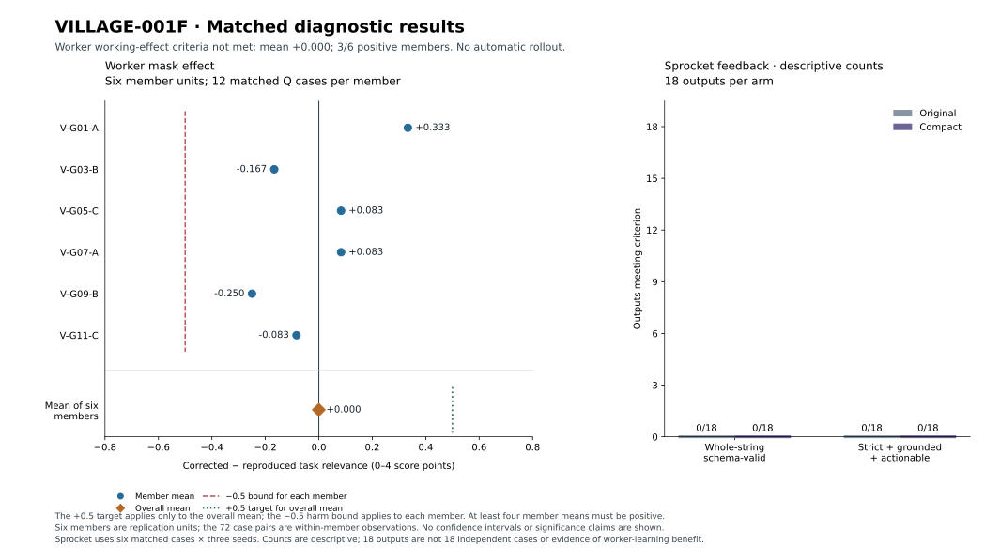

# VILLAGE-001F — completed matched diagnostics

**19 November 2026. The bounded experiment is complete; neither proposed repair meets its intended improvement criterion.** Corrected and reproduced D both average **1.75/4 task relevance**, giving an exact primary mean difference of **0**. Three of six member means improve and three decline. The compact Sprocket prompt produces **0/18 structurally valid critiques**, matching the original prompt's 0/18; its structure-required grounded/actionable count also remains zero.

The complete [published results](../results/REPORT.md), [machine-readable summary](../results/summary.json), [independent final acceptance](final-acceptance.json), and [final release](https://github.com/techrote/neurounner/releases/tag/village-001f-mask-sprocket-20261119) preserve the null and negative findings. Evidence acceptance passes; a positive scientific result is not required to accept a correctly completed experiment. [PR #257](https://github.com/techrote/neurounner/pull/257) merged the reviewed result at `9626737d2c373a7671941bfe3def381018b0336b`. The subsequent [independent main readback](main-readback.json) passes with `closure_ready:true`; [issue #256](https://github.com/techrote/neurounner/issues/256) records experiment closure.

## Relation to D, E and the village goal

Stage D was accepted first, followed by E on main at `498cbfb8caed6e962ee4dd7af951aa34281352e6`. E completed its qualification experiment but failed the usable-village gate: 14/36 members individually qualified, below the required 30. All 36 met E's frozen raw relevance/genericness minima; the individual failures concern recognition. The [E completion report](../../qualification-20261119/review/COMPLETION.md) remains authoritative for that outcome.

F's six-member panel, two training arms, twelve fresh Q cases, Sprocket cases and improvement criteria were fixed before the final E outcome. F tests attention-mask construction and feedback prompting. It does not directly test a repair of sibling recognition, replace E's final suite, or qualify a new population. [Epic #9](https://github.com/techrote/neurounner/issues/9) remains open.

## Primary worker result

Each member contributes twelve paired Q cases. The six member means are the replication units; 72 case/member differences are not 72 independently trained models. The primary comparison is corrected D minus a fresh historical-mask reproduction from the same C parent. The blinded evaluator sees both responses under opaque A/B labels, with all cases retained.

| Prespecified criterion | Actual result | Outcome |
|---|---:|---|
| Mean relevance gain at least +0.5/4 | **0/72 = 0** | Fail |
| At least four strictly positive member means | **3/6** | Fail |
| No member mean below −0.5/4 | Worst **−0.25** | Pass |

| Member | Reproduced relevance | Corrected relevance | Exact mean change |
|---|---:|---:|---:|
| V-G01-A | 1.4167 | 1.7500 | +1/3 |
| V-G03-B | 1.7500 | 1.5833 | −1/6 |
| V-G05-C | 1.4167 | 1.5000 | +1/12 |
| V-G07-A | 1.4167 | 1.5000 | +1/12 |
| V-G09-B | 2.1667 | 1.9167 | −1/4 |
| V-G11-C | 2.3333 | 2.2500 | −1/12 |
| Equal-member overall mean | **1.7500** | **1.7500** | **0** |

At case level, relevance improves in 11 comparisons, declines in 13 and ties in 48. The three +2 and eight +1 changes sum to +14; the twelve −1 and one −2 changes sum to −14. The evaluator's overall preference chooses corrected D 12 times, reproduced D 18 times and a tie 42 times. Five pairs have exactly identical response text and retain identical scalar scores and ties. These are descriptive secondary counts, not additional gates.

Mean coherence and groundedness each change by **−1/24 = −0.0417/4**. Genericness changes by **+1/72 = +0.0139/4**, where a higher score is more generic. The full [paired evidence](../results/worker-paired-effects.json) retains all members, case scores, reasons, exact-output comparisons and execution qualifications. [Independent worker analysis](worker/FINAL_FINDINGS.md) reproduces the blind identity mapping and exact integer/Fraction arithmetic without using the production aggregator.

This result supports a bounded conclusion: changing the attention mask altered weights and most outputs, but did not produce the predeclared average relevance improvement in this pilot. It does not show that the two training algorithms are equivalent in all settings, or that every member is unaffected.

## Controlled execution and the observed mechanism

Both arms use the same original C parent, sixty original D pairs per member, member seed, schedule, optimizer, objective, token IDs, target labels and pinned runtime. Twelve lanes perform 120 steps each, totaling **1,440 optimizer steps**. The only planned algorithmic difference is attention-mask construction. Each pair runs as two fresh processes on one member runner, in a predeclared 3+3 counterbalanced order.

Actual native evidence verifies **six fresh same-job/same-runner pairs**, twelve uninterrupted 0–120 trajectories, twelve invocations and 72 provenance sidecars. There are no checkpoint resumes, completed-copy invocations or unattributed retained steps. The new runs record Intel Xeon 6975P-C CPUs; historical D records AMD EPYC CPUs. Matching each new pair's execution controls does not establish numerical determinism or reconstruct historical D's weaker execution provenance. [Input acceptance](input-acceptance.json) checks these claims against the actual artifacts and API history.

The native token audit confirms three real turn-boundary tokens marked as padding by the historical rule in each of 720 chosen/rejected sequences: **2,160 masked input positions**. Two per sequence occur in the prompt; one is the penultimate assistant boundary, followed by a supervised newline. The shifted loss predicts the boundary from its preceding position and the newline at the boundary position. Attention changes do not delete either target label, and the 2,160 positions are not equally influential loss contributions.

The fixed-weight diagnostic performs **288 forward batches**: six members × BASE/C/original-D × eight original training pairs × two masks. All 144 pair rows change chosen/rejected mean log probabilities and their preference margin numerically; **no margin changes sign**. Mean margin shifts are −0.01525 for BASE, −0.00412 for C and −0.01954 for original D, in natural-log units. These are training-pair diagnostics, not additional held-out quality evaluations or per-boundary causal ablations. [Native and numerical findings](worker/INPUT_FINDINGS.md) retain every row and source hash.

## Historical reproduction and parameter distances

All 420 tensor hashes differ between original and reproduced D for every member. Exact historical weight reproduction therefore remains **false**. Nevertheless, **71/72 Q texts and generated-token arrays are identical**; G01-A supplies the one differing answer. Original-to-reproduced relative L2 differences range from **3.11×10⁻⁶ to 2.50×10⁻⁵**.

The corrected arm differs from its paired reproduction in all 420 tensor hashes per member, changes **67/72 Q answers**, and has relative L2 differences of **0.02797–0.04560**. These distances are computed directly from verified F32 safetensors bytes, promoted to float64 before subtraction. The complete [parameter-distance report](worker/adapter-distances.json) retains all eighteen archive identities and 5,040 per-tensor comparison records.

These are distances between LoRA factor parameters. They are not a metric of merged-model function or task quality, and do not identify the cause of historical numerical differences. The small reproduction differences and near-identical current Q behavior are useful controls; the frozen exact non-reproduction flags remain intact.

## Contextual task quality

BASE, C and original D were scored individually in separate requests using the same Q reserve. They provide context, while the paired corrected-versus-reproduced scores define the primary effect.

| Context stage | Responses | Relevance /4 | Coherence /4 | Genericness /4 | Groundedness /4 |
|---|---:|---:|---:|---:|---:|
| BASE | 12 | 1.7500 | 2.0833 | 2.9167 | 1.9167 |
| C | 72 | 1.6389 | 1.6667 | 2.1528 | 1.4583 |
| Original D | 72 | 2.1806 | 2.0833 | 1.8750 | 2.0278 |

All 300 worker responses are nonempty. The 160-token budget is exhausted without terminal EOS by **11/12 BASE** and **16/72 C** responses, versus none of the 216 original/reproduced/corrected D responses. These limits affect interpretation of the contextual levels. Do not join individually scored context means and paired-arm means into one calibrated training trajectory. E, D/T and F/Q also differ in prompts, representations and judging contexts; their absolute scores are not a before/after scale.

A separate [identical-text calibration check](worker/FINAL_FINDINGS.md) makes that limitation concrete. On the 71 cases where original and reproduced D have exactly the same prompt, response text and output tokens, individual-context relevance totals **154/71 = 2.1690**, while paired-reproduced relevance totals **125/71 = 1.7606**. The mean difference is **29/71 = 0.4085**; 29 scores agree, 33 are higher in the individual context and nine are lower. Different individual/paired requests, batches and a potentially stochastic unpinned critic confound attribution. This is descriptive evidence of rating variability, not a causal estimate of presentation effects or an additional gate. The primary comparison keeps both arms together in the same paired request.

## Sprocket result: structure and semantics

The feedback pilot contains six frozen existing T/P cases, three matched seeds per case and two prompt arms: **36 native outputs, eighteen matched case/seed pairs**. The compact arm combines a shorter system instruction, schema-first ordering and a valid example. It does not isolate schema position alone. Model weights, native template/runtime, source situation/response, seeds and sampling remain fixed; no new feedback trains a worker.

| Measurement | Original prompt | Compact prompt |
|---|---:|---:|
| Outputs | 18 | 18 |
| Whole-string schema-valid outputs | **0** | **0** |
| Grounded prose, with no unsupported claims | 9 | 8 |
| Outputs with unsupported claims | 9 | 9 |
| Mean response grounding /2 | 1.2222 | 1.0000 |
| Mean scenario grounding /2 | 1.7222 | 1.5000 |
| Mean corrective usefulness /2 | 0.8333 | 0.6667 |
| Structure + grounded + actionable | **0** | **0** |
| Reached 160-token cap | 14 | 15 |
| Empty output | 0 | 1 |

The frozen whole-string validity flag requires a JSON object accepted by the legacy field validator. That validator allows zero to three nonempty keep/mutate strings and ignores extra fields; it does not enforce the compact prompt's exact one-item instruction. In the actual data, none of the 36 responses is even a whole-string JSON value, so list-cardinality/extra-field checks have denominator zero.

Grounded prose requires response grounding and scenario grounding of at least one, with no unsupported-claims flag. The structure-required actionable conjunction additionally requires valid structure and usefulness of at least one. These definitions are preserved. Zero structured success does not imply every prose critique is useless: the blind critic identifies some grounded content in both arms. It also flags unsupported claims in half of each arm's outputs. Mean usefulness declines by **1/6**, and both mean grounding measures decline by **2/9**, in the compact arm.

The archived runtime/template checks pass. All actual prompt token IDs match native preflight; the longest prompt plus output allowance is 671 tokens, within the effective 2,048-token context. All seven outputs that stop before the cap also fail structure. These observations do not support a missing-template or simple context-overflow explanation for this run, and token-budget exhaustion does not explain every failure. Fresh original-prompt outputs match 0/18 historical raw texts, so this is a new matched pilot, not a replay of all 3,456 historical critiques. [Independent Sprocket interpretation and recomputation](SPROCKET_INTERPRETATION.md) retain the complete source-linked examples and semantic checks.

## Publication, accounting and acceptance

The [input release](https://github.com/techrote/neurounner/releases/tag/village-001f-pilot-inputs-20261119) targets `783a73ca7c8e97c3e03ef4e56fb5a5b125d58785`: twelve new adapter TARs plus the complete input TAR, **129,268,192 bytes** total. The [final release](https://github.com/techrote/neurounner/releases/tag/village-001f-mask-sprocket-20261119) targets `7ab26c67ad51b5273513e2bb7eeccbc2777d87ae`: four JSON reports plus the complete evidence TAR, **35,068,959 bytes** total. Summary SHA-256 is `4c356f6c8ecc622c9e7a30ad8183c5c42918a083ed58ba53b697c0fc85ea1f14`.

Generation [run 44467827716](https://github.com/techrote/neurounner/actions/runs/44467827716) and judging [run 44469833599](https://github.com/techrote/neurounner/actions/runs/44469833599) both complete on attempt one. The initial accepted-E merge did not create a push execution; isolated request revision 2 dispatched generation without altering any contract. Revision 3 begins judging only after independent input acceptance. No rerun or recovery resets the budget.

Actual provider accounting is **53 logical requests, 53 transport launches and 53 HTTP-attempt records**: 45 worker and eight Sprocket requests, against 50 baseline requests and the unchanged **114-request ceiling**. All bounded repairs and original provider outputs remain archived. Provider/metric/report reconstruction is byte-identical offline. No model, optimizer, tokenizer or provider executes during independent acceptance.

The publication audit verifies all eighteen assets across both releases, all 24 new/historical adapter byte inventories, the complete native workload, two-run Actions history, and exact TAR-to-Git agreement for 1,154 input-tag and 2,511 final-tag files. The [final acceptance report](final-acceptance.json), SHA-256 `c47336c618f9666fabe582623107281928fd6aff058ca684088e073f2cb62186`, is a bot-publication readback. Its main-closure flag is intentionally false because it predates integration. The subsequent [main readback](main-readback.json) at `9626737d2c373a7671941bfe3def381018b0336b` passes with `closure_ready:true`, SHA-256 `0f286f7ee6d67fe1b3d7dfc4ba8d81526e41d00f6969dfcfe468fe6ebbf45e59`. That full audit repeats source, input, final, adapter-byte, native, budget and offline-replay checks against freshly fetched main without new model or provider work. The [completion CI receipt](completion-ci/receipt.json) binds all eighteen terminal workflows at `c57159c0b009566cf579d4cc0458278e9d56b14f`: eight successes and ten skips, with no failures or cancellations. Source validation and 105 F tests pass normally and under optimized Python in the execution workflows.

## Research decision and remaining limits

The mask correction is an implemented, measured mechanism change; this pilot gives no basis for a 36-member quality rollout. The compact feedback prompt does not repair structured criticism or improve its frozen joint metric. All original D/E artifacts and failed members remain available, and E's qualification verdict is unchanged.

The next useful question is whether the original C curriculum teaches the desired practical behavior and whether C can reproduce suitable seen targets. The [C baseline audit](../C_BASELINE_AUDIT.md) documents positive targets that reward incomplete or counterproductive task behavior and proposes a separate 48-generation BASE/C seen-example diagnostic. That proposal is outside this completed F workload and has not executed here. A grammar could force JSON syntax in a future Sprocket experiment, but it would require separate grounding checks; neither syntax nor this prompt pilot establishes a benefit to worker learning.

Six selected members and twelve shared Q prompts do not establish population-wide generalization. Sprocket's three seeds are repeated observations within six selected cases. The remote critic backend is not version-pinned, and the archived ratings represent this request cohort. Exact collision checks do not establish semantic novelty. No confidence interval, significance claim, new acceptance gate or post-hoc member exclusion is introduced.
