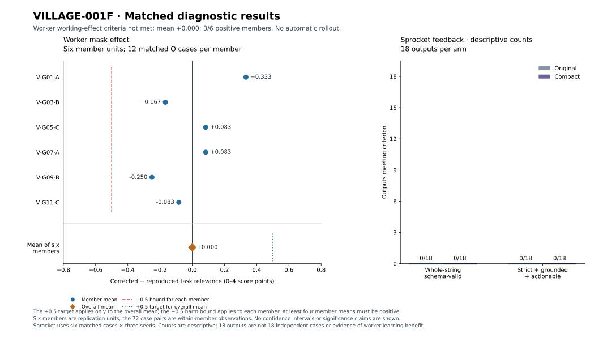

# Stage F worker results: independent reconstruction

The mask correction did **not** meet the prespecified working-effect criteria. Corrected and reproduced responses both average **1.75/4 task relevance**, giving an exact paired mean change of **0**. Three of six member means improve; the worst member mean change is **−0.25**, within the frozen −0.5 harm bound. These observations support neither a 36-member rollout nor a claim that this masking defect explains the earlier quality limitations.

Final publication: [`7ab26c67ad51b5273513e2bb7eeccbc2777d87ae`](https://github.com/techrote/neurounner/tree/7ab26c67ad51b5273513e2bb7eeccbc2777d87ae/experiments/village-001/diagnostic-20261119), tag `village-001f-mask-sprocket-20261119`; judge run [`44469833599`](https://github.com/techrote/neurounner/actions/runs/44469833599). The scientific panel, data, masks, objective, steps and thresholds remained frozen.

The dashed −0.5 line applies to each member; the dotted +0.5 target applies only to the separate overall-mean row. Six members are replication units. No confidence intervals or significance claims are added. The Sprocket panel shows zero schema-valid and zero strict+grounded+actionable outputs out of eighteen in each arm; the colored baseline strokes indicate actual zero counts.

## Exact primary reconstruction

All 72 blind primary identities/orientations were reconstructed from the frozen mapping rules and joined to the native output texts. Scores remain raw integers. Each member mean is its twelve integer deltas divided by twelve; the overall estimate is the sum of all 72 integer deltas divided by 72, equal to the mean of the six member means. The production aggregation function was not called.

| Member | Reproduced relevance | Corrected relevance | Exact corrected−reproduced change |
|---|---:|---:|---:|
| V-G01-A | 1.416667 | 1.750000 | 1/3 |
| V-G03-B | 1.750000 | 1.583333 | -1/6 |
| V-G05-C | 1.416667 | 1.500000 | 1/12 |
| V-G07-A | 1.416667 | 1.500000 | 1/12 |
| V-G09-B | 2.166667 | 1.916667 | -1/4 |
| V-G11-C | 2.333333 | 2.250000 | -1/12 |

| Frozen criterion | Observed | Result |
|---|---:|---|
| Overall relevance gain ≥ +0.5 | 0 | Not met |
| At least four positive member means | 3/6 | Not met |
| No member mean below −0.5 | Worst −0.25 | Met |

Across cases, relevance is unchanged in 48/72, increases in 11/72 and decreases in 13/72; the integer changes sum to zero. The separate preference-winner field favors corrected D on 12 cases, reproduced D on 18, and records 42 ties. These descriptive case counts do not create independent model replications or replace the frozen member-level criteria.

Other corrected-minus-reproduced score changes are coherence **−1/24**, groundedness **−1/24** and genericness **+1/72**. Higher genericness means more generic according to the frozen rubric. All case scores, reasons and exact rational summaries remain in [worker-primary-reconstruction.json](worker-primary-reconstruction.json).

## What the mechanism and reproduction checks establish

The final analysis reconfirms the accepted inputs without changes: 12 fresh training histories, 1,440 steps, 300 responses, 720 audited sequences and 288 fixed-forward batches. Its input-analysis JSON is byte-identical to the preserved pre-judge report. All six paired training executions satisfy the actual same-job/runner and predeclared-order checks.

The native audit demonstrates that the historical rule masks two prompt boundaries and one assistant boundary in every chosen/rejected sequence. The assistant boundary is penultimate and can affect the following supervised newline prediction; its own target is predicted from the preceding position. No target label is deleted. All 144 fixed-weight pair rows change both mean log probabilities and their margin, with zero margin-sign flips. This shows a computationally active change, without treating boundary positions as equally influential loss contributions.

All 420 tensor hashes per adapter differ in both comparisons. Original-D→reproduced relative L2 distances are about **0.0000031–0.0000250**; reproduced→corrected distances are about **0.0280–0.0456**. Original D and reproduction match exactly on 71/72 Q texts/token arrays, while corrected and reproduced match on 5/72. The mask intervention changes weights and most outputs without improving the primary mean score in this pilot. Parameter distance is not a task-quality or full-model-function metric, and exact reproduction remains false.

The complete pre-judge measurements remain in [INPUT_FINDINGS.md](INPUT_FINDINGS.md), [adapter-distances.json](adapter-distances.json) and [worker-input-findings.json](worker-input-findings.json). Those files are preserved as historical input-only analyses, including their then-pending quality status.

## Descriptive check of judging context

At the operator’s request after results were visible, an additional calibration description joins original-D individual-context ratings to primary reproduced-D ratings only when the prompt, response text and generated token array are exactly identical. **71 cases** qualify; **V-G01-A/Q10** is excluded because its text differs. This is an after-the-fact descriptive check, not a new gate or an adjusted primary estimate.

| Metric | Individual-context mean | Paired-reproduced mean | Exact context−paired difference | Equal / higher / lower context score |
|---|---:|---:|---:|---|
| task relevance | 2.169014 | 1.760563 | 29/71 | 29 / 33 / 9 |
| coherence | 2.084507 | 2.070423 | 1/71 | 25 / 25 / 21 |
| genericness | 1.873239 | 2.380282 | -36/71 | 28 / 10 / 33 |
| groundedness | 2.014085 | 1.971831 | 3/71 | 24 / 25 / 22 |

On identical text, relevance averages **154/71 = 2.169014** in individual requests and **125/71 = 1.760563** on the reproduced side of paired requests: a descriptive difference of **29/71 = +0.408451**. The mean absolute relevance difference is **47/71 = 0.661972**. Exact rating agreement occurs on 29 cases; individual-context relevance is higher on 33 and lower on 9.

The requests differ in individual versus paired presentation, comparison response, batching and execution. The remote backend is unpinned and may be stochastic. This observational contrast cannot isolate a causal effect of presentation, batch, order or backend variation. It reinforces why contextual BASE/C/original-D levels must not be joined with paired-arm levels as a single causal training trajectory; it does not modify the primary corrected-versus-reproduced result. The complete join, source hashes and raw score differences are in [identical-text-rating-contexts.json](identical-text-rating-contexts.json).

## Contextual scores and limits

The 156 contextual blind identities were independently reconstructed and their raw scores recomputed. These are separately scored individual responses, with denominators of 12 for BASE and 72 each for C and original D. They provide context, with the calibration limitations above.

| Contextual stage | Responses | Relevance | Coherence | Genericness | Groundedness |
|---|---:|---:|---:|---:|---:|
| BASE | 12 | 1.750000 | 2.083333 | 2.916667 | 1.916667 |
| C | 72 | 1.638889 | 1.666667 | 2.152778 | 1.458333 |
| D_ORIGINAL | 72 | 2.180556 | 2.083333 | 1.875000 | 2.027778 |

Native generation reached the 160-token cap without terminal EOS in 11/12 BASE responses and 16/72 C responses, and in none of the 216 D-stage responses. The six prespecified members and twelve shared prompts do not establish full-population generalization. The absence of a member exceeding the harm bound is not proof of absence of harm beyond these observations. Original D differs from its reproduction in recorded hardware/platform and exact parameter bytes; this qualifies historical comparisons without removing any member.

For Sprocket, the plotted structure/usefulness conjunction remains zero in both arms. The separate [Sprocket interpretation](../SPROCKET_INTERPRETATION.md) owns its full semantic and native-wire analysis. Its six cases and repeated seeds are descriptive observations, not evidence of benefit to worker learning.

## Reproduce and inspect

- [Final analysis receipt](final-analysis-receipt.json) binds the independent input and primary reconstruction outputs.
- [Figure provenance](figures/figure-provenance.json) binds the exact final summary, source commit, plotting script, SVG and PNG; the [PNG preview](figures/preview.png) was visually inspected.
- [Final custody](final-worker-custody.json) binds the publication and source files.
- [Final bundle manifest](final-bundle-manifest.json) inventories the additive final files while preserving the earlier input manifest and all pre-judge files.

Run `rederive_worker_evidence.py --repo REPO --phase final --out NEW_SCRATCH_DIR` for the complete offline reconstruction. Run `compare_rating_contexts.py --repo REPO --reconstruction NEW_SCRATCH_DIR/worker-primary-reconstruction.json --out NEW_JSON` for the separate identical-text description. The final figure uses `plot_worker_results_final.py` with the published `results/summary.json`, `--include-sprocket`, source commit `7ab26c67ad51b5273513e2bb7eeccbc2777d87ae` and new SVG/PNG paths. The original pre-judge plot script remains unchanged; the final variant only fixes the observed label layout and displays zero-count baseline markers. No model, tokenizer or provider was called by these analyses.
