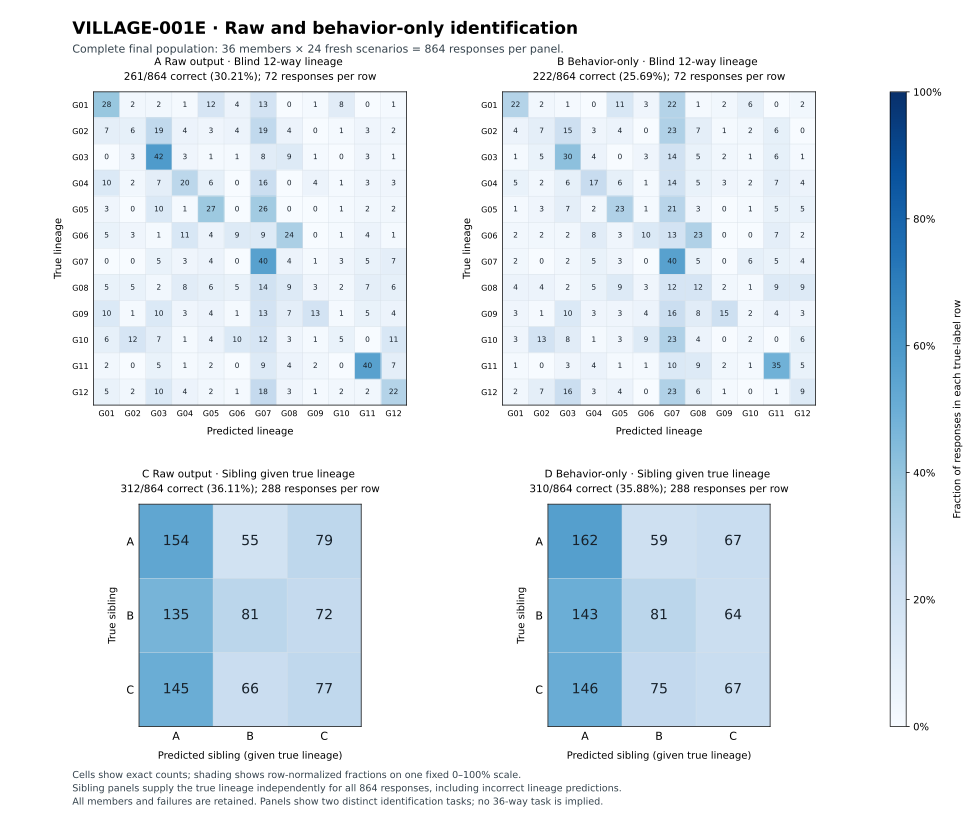

# VILLAGE-001E — completed qualification and interpretation

**Stage E completed its final experiment and independent publication audit. The 36-member population does not satisfy the predeclared usable-village gate.** Behavioral lineage identification survives style removal, but sibling identification is insufficient and only 14 of 36 members pass every individual requirement. All members, including the 22 individual failures, remain in the evidence and model registry. The negative qualification result completes the experiment; it does not complete the usable-village objective of [epic #9](https://github.com/techrote/neurounner/issues/9).

The authoritative frozen outputs are the [population report](../../final-evidence/REPORT.md), [summary](../../final-evidence/summary.json), [member verdicts](../../final-evidence/per-member-verdicts.json), [ecology report](../../final-evidence/ECOLOGY_REPORT.md), and [immutable release](https://github.com/techrote/neurounner/releases/tag/village-001e-final-20261119). They were published at commit [869aef67](https://github.com/techrote/neurounner/commit/869aef679144a655dbf301aafc63ebb4fad36485) by successful [run 44459799532](https://github.com/techrote/neurounner/actions/runs/44459799532). This supplement interprets those unchanged outputs and documents their acceptance.

## Frozen population gates

| Requirement | Measured result | Frozen requirement | Outcome |
|---|---:|---:|---|
| Behavior-only blind lineage identification | 222/864 = 25.6944% | At least 0.1666666667; effectively 145/864 | Pass |
| Behavior-only sibling identification, given true lineage | 310/864 = 35.8796% | At least 0.4166666667; effectively 361/864 | Fail |
| Mean raw genericness below the contemporaneous BASE | 1.7523 versus 2.1250 | Strictly lower | Pass |
| Members passing every individual check | 14/36 | At least 30/36 | Fail |

The literals above are preserved from the [frozen configuration](../config.json). Replacing them with exact one-sixth or five-twelfths would move each population boundary by one correct response. The [independent audit](stage-e-acceptance.json) recomputed the gates from complete evidence and agrees with the recorded false usable-village verdict.

Individual gates require accepted D maturation, at least 3 of 24 behavioral lineage hits, at least 8 of 24 conditioned sibling hits, mean raw relevance at least 2.5/4, and mean raw genericness at most 2/4. **All 36 members meet the maturation, raw relevance and raw genericness criteria.** Twenty fail sibling identification, ten fail lineage identification, and eight fail both; their union is 22 individual failures. The deficit is insufficient reliable member recognition under this protocol, rather than failure of its raw quality minima. These are fixed acceptance thresholds on a small suite, not independent statistical guarantees for each cartridge. Sources: [member table](../../final-evidence/summary.json) and [complete verdicts](../../final-evidence/per-member-verdicts.json).

## Identification and task-quality measurements

| Measurement | Raw outputs | Behavior-only summaries |
|---|---:|---:|
| Blind lineage identification | 261/864 = 30.2083% | 222/864 = 25.6944% |
| Sibling identification given true lineage | 312/864 = 36.1111% | 310/864 = 35.8796% |
| Joint correctness of the two separate tasks | 105/864 = 12.1528% | 86/864 = 9.9537% |
| Member mean task relevance /4 | 3.1921 | 2.8345 |
| Same-suite BASE task relevance /4 | 3.0833 | 3.2500 |
| Member mean genericness /4 | 1.7523 | 1.8137 |
| Same-suite BASE genericness /4 | 2.1250 | 1.9167 |

Sources: [matrices](../../final-evidence/confusion-matrices.json), [summary](../../final-evidence/summary.json), and [figure provenance](village-001e-confusion.provenance.json). The [plotting code](plot_village_001e_confusion.py) checks all labels, all 36 members, each row total, the complete suite hash, and agreement with aggregate and per-member accuracies before rendering.

Lineage accuracy falls by 4.5139 percentage points after style neutralization but remains above the frozen gate. The sibling result changes by only 0.2315 points and remains below its gate. This supports some surviving lineage signal with weak separation among same-lineage siblings; it does not establish 36 reliably distinct identities.

Predictions are uneven: G07 receives 231 of 864 behavior-only lineage predictions, although each true lineage contributes 72 responses. Sibling A receives 434/864 raw predictions and 451/864 behavior-only predictions, although each true sibling contributes 288 responses. These concentrations are visible in the figure and [complete matrices](../../final-evidence/confusion-matrices.json). Confusion alone cannot distinguish output convergence from classifier or reference-card bias. The primary classifier is the same Bolt model for both representations; the frozen low-confidence Super trigger selects zero tournament response records, so this is not a multi-judge replication. Ecology's 16 selective Super audits are a separate evaluation.

The sibling judge receives the correct lineage for **every** response. Its denominator is all 864 member responses, independent of the first judge's lineage prediction. The 36×36 member matrices combine the two predictions; they are not a third unconstrained blind 36-way task. Each member's five nearest recorded confusions are retained, including zero-count ties where the fixed five-entry format requires them. Sources: [matrix interpretation](../../final-evidence/confusion-matrices.json) and [member verdicts](../../final-evidence/per-member-verdicts.json).

The raw relevance difference from BASE is +0.1088/4; it is a descriptive result for this suite and judge cohort, not a demonstrated general advantage. The behavior-only ratings concern a different representation. Neither contrast establishes a training-stage improvement. In particular, D's approximately 1.0035/4 relevance on its reused T diagnostics and E's 3.1921/4 on fresh F prompts use different cohorts and judging contexts, while E uses the same accepted D weights and performs **zero optimizer steps**. Those means are not a calibrated before/after estimate. Sources: [final-quality fields](../../final-evidence/summary.json) and [D report](../../preference-evidence/REPORT.md).

The fresh F suite contains six families with four scenarios each. Abstract/unfamiliar cases reach 26/144 behavioral lineage hits and 50/144 conditioned sibling hits; failure/recovery cases reach 42/144 and 53/144. These family subsets describe the same fixed experiment and do not replace the full-population gates. The suite has no exact normalized input collisions with the 3,383 earlier inputs checked at construction; that check does not establish complete semantic novelty. Sources: [family results](../../final-evidence/summary.json), [suite](../../final-evidence/final-eval.json), and [suite construction](../../../../scripts/village_001e_build_final_suite.py).

## Ecology: distinct behavior with limited collective progress

All 24 sessions completed: 12 same-lineage pairs and 12 cross-lineage groups, three rounds each, 180 turns, and 60 participant appearances covering all 36 members. Mean differentiation is 1.3333/4 and mean outcome progress is 0.6667/4; no session scores above 2 on either measure. The [detailed interpretation](ECOLOGY_INTERPRETATION.md) links representative transcripts, all member-level dominance/deference ratings, exact numerical summaries and the limits of each comparison.

The separate cross-lineage audit records mean expected-lineage fit 1.1944/4, distinction survival 0.9722/4 and contamination 0.0833/4. Low diagnosed replacement by another lineage therefore coexists with weak fit to the expected lineage; it does not establish strong identity preservation. This audit differs from the primary wording/stance-copying measure. Sources: [ecology summary](../../final-evidence/ecology-summary.json) and [independent analysis](analysis.json).

Super was applied selectively to 16 low-differentiation sessions. It flagged convergence concerns in ten of those 16; eight sessions were unaudited. Its findings are not an unbiased population prevalence estimate or an independent blinded replicate, because it also receives the primary judgment. E-P-G05 retains an explicit inconsistency: the first valid boolean says distinctions do not survive, while a later reason-only repair describes observable differences. Both are preserved under the first-valid policy. Sources and exact public outputs are linked in the [ecology interpretation](ECOLOGY_INTERPRETATION.md#lineage-fit-and-selective-super-audit).

Appearance-weighted dominance is 1.2167/4 and deference 0.9833/4. A/B members each appear twice and C members once; equal member weighting instead gives 1.1944 and 1.0139. All six deference ratings of 2 occur at handle M2 under a fixed turn order. These are contextual observations, not evidence of stable social hierarchy. There is no matched BASE or Stage C ecology control, and 33 of 180 turns reach the 96-token cap. The ecology remains descriptive and is not an added population gate. See [full analysis and source hashes](analysis.json), [recomputation tool](recompute_ecology.py), and [generator provenance](PROVENANCE.md).

## Evidence completion and independent readback

The [independent publication audit](stage-e-acceptance.json) verified 61 native generation chains, 1,190 generation inventory files, all 888 final responses and 180 ecology turns, and offline reconstruction of all 48 provider lanes. Re-running the unchanged strict assembler produced byte-identical final evidence and promoted datasets: 5,204 final-evidence files and 8,266 dataset inventory records. All eight downloaded release assets match API sizes and SHA-256s; 11,624 tagged Git files match the complete evidence TAR.

The original 27 provider ZIPs, 21 independently rederived zero-call identities, and the exact 3,782-file prior recovery ZIP are preserved. All 41 previously completed lane trees survive unchanged, and all 48 allocation-extension receipt reconciliations have zero gaps. The known first-recovery F19 interruption remains explicit: three logical requests and three transport launches lack a native-v1 receipt and are reconciled from the frozen raw inventory and verified prior ZIP. The continuation did not invent that receipt or overwrite earlier valid judgments. Sources: [audit](stage-e-acceptance.json) and [recovery accounting](../provider-recovery/accounting.json).

Final spending is **860 logical requests and 862 transport launches**, including 187 new logical requests in the last continuation. This remains below the 1,059 allocated limit and the original 1,104 global ceiling. The [recovery protocol and amendments](../provider-recovery/README.md) retain the original requests, first-valid values, repair schedule, failed attempts and source bindings. The original D adapters remain the registry entries; E publishes evaluation evidence without retraining. Sources: [accounting](../provider-recovery/accounting.json), [registry](../../final-evidence/model-registry.json), and [terminal execution custody](execution/custody.json).

The copied publication audit intentionally predates the documentation merge and therefore records main/documentation closure as not yet evaluated. Final issue closure requires a separate fresh-main readback with both requirements enabled. The original audit is retained unchanged rather than rewritten to claim that later step occurred earlier.

## Continuation

[Stage F #256](https://github.com/techrote/neurounner/issues/256) is the bounded next experiment: matched historical versus length-derived attention masks for six fixed members, plus a native Sprocket feedback-prompt diagnostic. Its panel, data, criteria and budgets were fixed before these E outcomes. The observed D attention-mask defect is a concrete mechanism to test; E does not establish it as the cause of sibling confusion or weak ecology. F will bind the accepted E main commit and summary before execution and will retain the full negative E result. A small causal pilot does not automatically qualify or retrain a 36-member replacement population.
